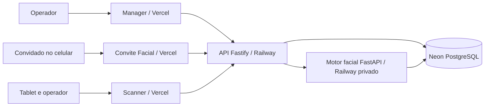

# Arquitetura e fluxos

## Limites dos serviços

Manager, Convite e Scanner são três projetos Next.js independentes, publicados na Vercel. Suas rotas servidoras chamam a API Railway por HTTPS. O navegador não recebe credenciais do banco ou do motor facial. A API concentra autenticação, autorização por cliente, convites, estado do evento e registro de acesso. O motor facial recebe chamadas da API por domínio privado Railway, extrai um vetor da imagem e lê/grava modelos criptografados no Neon.

`packages/contracts` fornece esquemas Zod e tipos para serviços Node. `packages/db` contém SQL versionado, migrador e bootstrap inicial do administrador. Cada serviço tem ciclo de implantação separado, mas depende de contratos de dados comuns.

## Ciclo de vida

1. `adm` cadastra cliente; `adm` ou gestor vinculado cria evento e convidados no Manager ou na API.
2. A API gera para cada convidado um token aleatório de 32 bytes, persiste apenas seu SHA-256 e devolve a URL `Convite/convite/{token}` ao operador. O envio por WhatsApp/e-mail é manual.
3. O convidado abre o link e aceita com consentimento. Sem perfil anterior no mesmo cliente, captura uma única face e o motor a transforma em vetor criptografado. Com perfil elegível já associado ao mesmo e-mail ou telefone, confirma sem nova foto.
4. O operador ativa o evento. O Scanner autentica um usuário autorizado, seleciona o evento ativo e solicita a câmera. O operador escolhe **entrada** ou **saída**.
5. A API pede identificação ao motor facial restrita aos convidados aceitos daquele evento. Registra `entry`, `exit` ou `denied` com motivo. Duplicidade e saída sem entrada são negadas.
6. O Manager consulta o histórico e pode finalizar o evento. A finalização impede novos scans e novos aceites para aquele evento.

## Falha e consistência

O motor facial não decide sozinho a entrada: ele retorna `match`, `no_match` ou `review`; a API verifica convite aceito, evento ativo, janela de horário, escopo do operador e estado anterior de acesso. A API retorna 503 se o motor não responder; não libera a entrada. Tentativas com imagem inválida, sem correspondência, em revisão e duplicadas geram `access_events` negados. Uma indisponibilidade do motor retorna 503 sem criar registro de tentativa. O aceite e a criação de seu evento de auditoria usam transação SQL; o cadastro do vetor é uma chamada anterior à transação e pode deixar perfil órfão se o aceite falhar depois.

## Fronteiras de confiança

- Link de convite: credencial de posse individual; quem obtém o URL pode abrir o convite. Compartilhe por canal apropriado e não o registre em logs.
- Sessão da aplicação: cookie `HttpOnly` nas interfaces; token opaco na API externa. A API valida papel e vínculo de cliente em toda operação.
- Motor facial: Bearer compartilhado, URL privada, sem acesso direto do navegador.
- Banco: API e motor acessam Neon com segredos de ambiente independentes.

Consulte [segurança](security-and-biometrics.md) para limites de autenticação, privacidade e reconhecimento.
