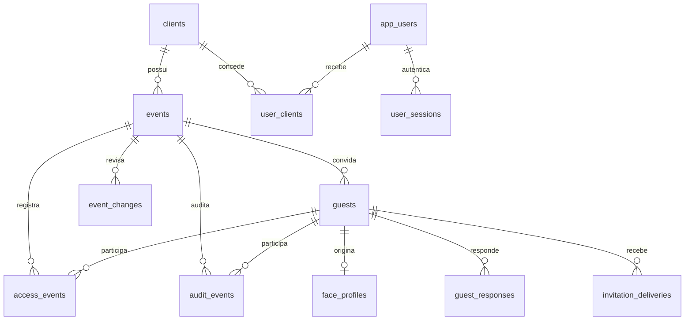

# Modelo de dados e migrações

O banco é PostgreSQL no Neon. O SQL é fonte de verdade: `packages/db/migrations/001_initial.sql` a `009_event_cancellation_notices.sql`. O migrador `packages/db/src/migrate.mjs` registra versões em `schema_migrations`. A aplicação usa `DATABASE_URL` com pooler; migrações usam preferencialmente `DATABASE_URL_UNPOOLED`.

## Relações

| Tabela | Dados essenciais | Regras |
| --- | --- | --- |
| `clients` | `id`, `name`, `external_id`, `active` | `external_id` único; cadastro de organização |
| `app_users` | identidade, email, hash da senha, papel, ativo, troca obrigatória, falhas/bloqueio | email único sem diferenciar caixa |
| `user_clients` | usuário, cliente, concedido por | chave composta; gestor pode ter múltiplos clientes |
| `user_sessions` | SHA-256 do token, usuário, validade, revogação | token em claro nunca é persistido |
| `events` | cliente, `external_id`, nome, horários, fuso, local, status, revisão | fim > início; `external_id` único dentro do cliente |
| `guests` | evento, nome, email/telefone, hash do link, status, aceite, `person_face_id`, revisão confirmada | email ou telefone obrigatório; únicos entre registros não excluídos por evento |
| `person_face_profiles` / `person_face_contacts` | foto e vetor cifrados, contatos associados | identidade reutilizada entre eventos após confirmação |
| `invitation_tokens` / `invitation_deliveries` | links adicionais e tentativas de envio | registra canal, resultado, finalidade e revisão |
| `event_changes` | ator, motivo, antes/depois, revisão | audita edição e cancelamento |
| `guest_responses` | convidado, revisão, aceite/recusa, horário | preserva respostas anteriores após reagendamento |
| `access_events` | evento, convidado opcional, ação, motivo, confiança, horário | entrada, saída ou negativa; negativa exige motivo |
| `audit_events` | evento, convidado, ação, detalhes JSON, horário | atualmente registra aceite do convite |

`face_profiles` e `guests.face_profile_id` são estruturas legadas mantidas para compatibilidade de migração. O fluxo atual usa `person_face_profiles` e `guests.person_face_id`. A foto e o vetor são cifrados; a confirmação de presença continua vinculada ao convidado e à revisão do evento.

## Estados

Evento: `draft` na criação; `published` existe no esquema, sem rota publicada; `active` por `/activate`; `finished` por `/finish` ou automaticamente quando `ends_at <= now()`; `cancelled` por `/cancel`. O encerramento automático vale para eventos em `draft`, `published` ou `active`, preserva os cancelados e registra `audit_events.action = event_auto_finished`. Convite: `registered`, `invited`, `accepted`, `reconfirmation_pending`, `attended` e `declined`; `expired` existe sem fluxo completo. `accepted_at` preserva o primeiro aceite, enquanto `guest_responses` guarda cada resposta por revisão. Evento finalizado ou cancelado não pode ser reativado pela rota atual. [Regras de edição](event-editing-and-reconfirmation.md).

## Integridade e consultas

Há índices por evento/hora no histórico, por convidado/hora no acesso, por cliente nos eventos e por usuário em sessões/vínculos. As relações usam UUID, datas `timestamptz` e `ON DELETE RESTRICT` para dados de evento; por isso, exclusão direta requer política explícita. O histórico HTTP retorna até 500 itens por evento em ordem cronológica crescente, sem paginação. Ainda não existe tabela de depoimentos, redes sociais ou agregados de permanência.

## Migração segura

Crie uma migração nova, nunca altere as anteriores já aplicadas. Execute no banco de destino antes do deploy do código dependente. Faça backup/restore testado antes de alterações destrutivas. Migrações não devem ser executadas por toda instância da API na partida; use etapa operacional controlada. Não inclua `DATABASE_URL` real em documentação ou Git.
