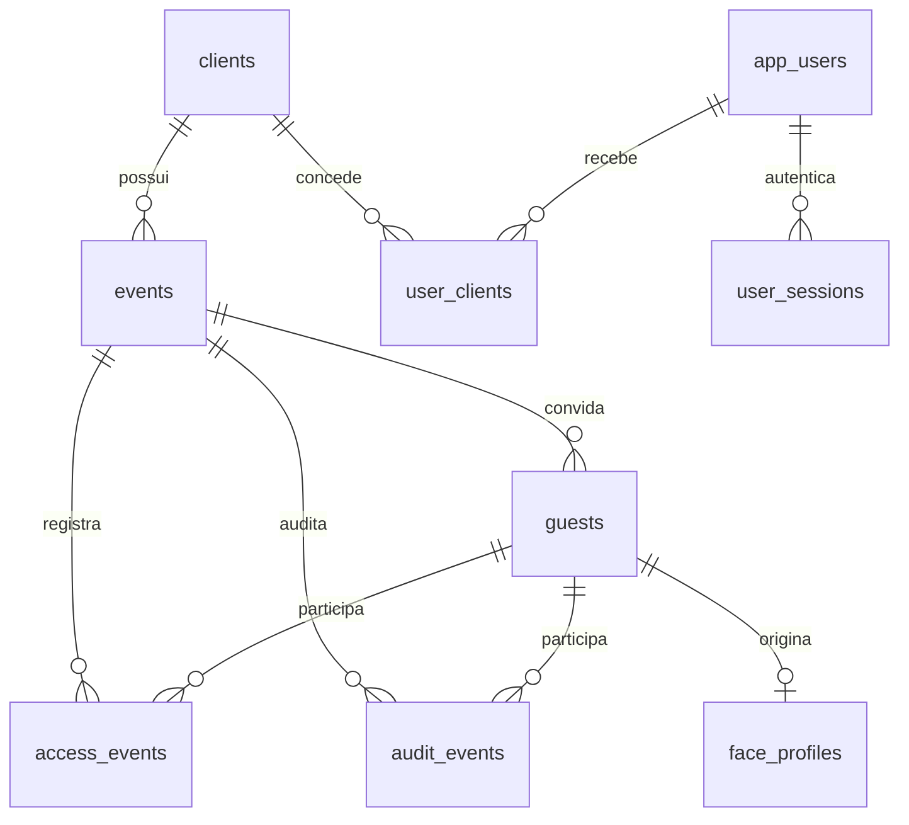

# Modelo de dados e migrações

O banco é PostgreSQL no Neon. O SQL é fonte de verdade: `packages/db/migrations/001_initial.sql` a `004_face_profiles.sql`. O migrador `packages/db/src/migrate.mjs` registra versões em `schema_migrations`. A aplicação usa `DATABASE_URL` com pooler; migrações usam preferencialmente `DATABASE_URL_UNPOOLED`.

## Relações

| Tabela | Dados essenciais | Regras |
| --- | --- | --- |
| `clients` | `id`, `name`, `external_id`, `active` | `external_id` único; cadastro de organização |
| `app_users` | identidade, email, hash da senha, papel, ativo, troca obrigatória, falhas/bloqueio | email único sem diferenciar caixa |
| `user_clients` | usuário, cliente, concedido por | chave composta; gestor pode ter múltiplos clientes |
| `user_sessions` | SHA-256 do token, usuário, validade, revogação | token em claro nunca é persistido |
| `events` | cliente, `external_id`, nome, horários, fuso, local, status | fim > início; `external_id` único dentro do cliente |
| `guests` | evento, nome, email/telefone, hash do link, status, aceite, `face_profile_id` | email ou telefone obrigatório; únicos por evento |
| `face_profiles` | convidado original, vetor cifrado, modelo, criação | um perfil originário por convidado |
| `access_events` | evento, convidado opcional, ação, motivo, confiança, horário | entrada, saída ou negativa; negativa exige motivo |
| `audit_events` | evento, convidado, ação, detalhes JSON, horário | atualmente registra aceite do convite |

`guests.face_profile_id` é um identificador textual de perfil, mas **não tem chave estrangeira SQL** para `face_profiles.id`. A reutilização associa o mesmo perfil a outro convidado do mesmo cliente. Isso simplifica o vínculo, mas a integridade dessa referência depende da aplicação.

## Estados

Evento: `draft` na criação; `published` existe no esquema, porém sem rota publicada para essa transição; `active` por `/activate` a partir de `draft` ou `published`; `finished` por `/finish` a partir de `active`; `cancelled` existe no esquema, sem rota específica. Convite: `pending` na criação e `accepted` no aceite; `declined`/`expired` existem no esquema, sem rotas correspondentes. A coluna `accepted_at` é preenchida uma vez. Um evento finalizado não pode ser reativado pela rota atual.

## Integridade e consultas

Há índices por evento/hora no histórico, por convidado/hora no acesso, por cliente nos eventos e por usuário em sessões/vínculos. As relações usam UUID, datas `timestamptz` e `ON DELETE RESTRICT` para dados de evento; por isso, exclusão direta requer política explícita. O histórico HTTP retorna até 500 itens por evento em ordem cronológica crescente, sem paginação. Ainda não existe tabela de depoimentos, redes sociais ou agregados de permanência.

## Migração segura

Crie uma migração nova, nunca altere as anteriores já aplicadas. Execute no banco de destino antes do deploy do código dependente. Faça backup/restore testado antes de alterações destrutivas. Migrações não devem ser executadas por toda instância da API na partida; use etapa operacional controlada. Não inclua `DATABASE_URL` real em documentação ou Git.
